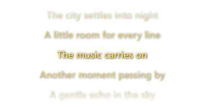
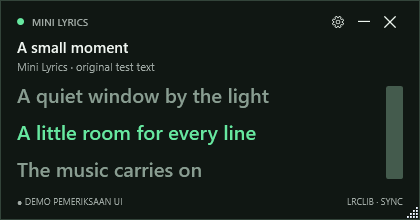
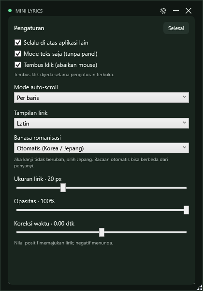

# Mini Lyrics for Spotify

Aplikasi Windows dengan lirik mengambang, teks kuning, auto-scroll, fade atas/bawah, dan mode tembus klik. Mengikuti Spotify desktop melalui Windows Media Sessions, tanpa login, cookie, atau Spotify Web API.

[Download EXE Windows x64](https://github.com/masidiq/mini-lyrics-for-spotify/releases/latest) · [Changelog](CHANGELOG.md)

## Screenshot

Mode teks transparan dengan auto-scroll dan fade:



Panel biasa:



Pengaturan:



Screenshot menggunakan teks demo, bukan lirik lagu atau tampilan desktop pengguna. Background gambar mode teks transparan.

Romanisasi Jepang (Latin + Asli) dan Korea:


Preview baris pertama saat intro:


## Jalankan

1. Jalankan build lokal terbaru dari `artifacts/latest/MiniLyricsForSpotify.exe`, atau unduh EXE dari [GitHub Releases](https://github.com/masidiq/mini-lyrics-for-spotify/releases/latest). Keluar dari versi lama lewat menu tray **Keluar** terlebih dahulu jika masih berjalan.
2. Buka Spotify **desktop di komputer yang sama**, lalu putar lagu.
3. Tunggu judul dan lirik muncul. Pencarian awal memerlukan internet; lirik yang sudah tersimpan dapat dimuat dari cache.

EXE release **portable, single-file, dan self-contained Windows x64** menyertakan runtime .NET 10.0.6. Tidak perlu memasang .NET atau menyalin DLL terpisah. Target minimum: Windows 10 versi 2004/build 19041; build dan pemeriksaan runtime dilakukan pada Windows 11. EXE belum ditandatangani secara digital.

Release memuat `CHANGELOG.md`, `verification.log`, `smoke-test.json`, `THIRD-PARTY-NOTICES.md`, `licenses.zip`, dan `SHA256SUMS.txt`. Simpan notices dan lisensi bersama EXE. Periksa checksum EXE yang diunduh dengan `Get-FileHash <nama-file.exe> -Algorithm SHA256`, lalu bandingkan dengan `SHA256SUMS.txt` dari release yang sama.

## Kontrol

- **Mulai otomatis bersama Spotify** tersedia di Pengaturan dan tray, default nonaktif. Jika aktif, Mini Lyrics berjalan di tray sejak login Windows, menampilkan lirik saat proses Spotify desktop dibuka, lalu menyembunyikannya saat Spotify ditutup (pemeriksaan sekitar 2 detik). Pengaturan tetap bisa dibuka dari tray tanpa Spotify. Jika disembunyikan manual, lirik muncul lagi ketika Spotify ditutup lalu dibuka kembali. **Keluar** menghentikan pemantauan sampai Mini Lyrics dijalankan lagi atau login Windows berikutnya.
- Simpan EXE di lokasi tetap sebelum mengaktifkan opsi ini. Startup Windows memakai lokasi EXE saat opsi diaktifkan; jika dipindah, jalankan EXE dari lokasi baru agar pendaftaran diperbarui. Menonaktifkan opsi menghapus pendaftaran startup untuk pengguna Windows saat ini.

- Geser header untuk memindahkan panel; tarik tepi/sudut untuk mengubah ukuran. Ukuran awal 420 × 220.
- Seluruh area kosong header dan area judul/artis menerima drag; tidak harus tepat mengenai teks atau logo.
- Aplikasi langsung membuka **mode teks saja**: beberapa baris lirik kuning dengan shadow hitam, tanpa background, header, tombol, atau resize grip. Baris aktif terlihat terang di tengah; baris sekitarnya lebih redup, dan tepi atas/bawah memudar sampai transparan. Lirik bertimestamp otomatis bergulir dengan transisi 400 ms; seek ke baris jauh langsung memusatkan ulang. Pengaturan lama dimigrasikan satu kali ke mode ini. Geser teks untuk memindahkannya. Lirik biasa tanpa timestamp digulir manual menggunakan mouse wheel.
- Hilangkan centang **Mode teks saja** untuk kembali ke panel. Pengaturan dan coba ambil lirik lagi juga tersedia di menu tray. Membuka pengaturan dari mode teks menampilkan panel sementara; **Selesai** mengembalikan tampilan teks saja. Pilihan mode tersimpan saat restart.
- **Tembus klik (abaikan mouse)** aktif secara default: klik kiri/kanan, drag, dan scroll melewati seluruh window lirik ke aplikasi di belakangnya. Auto-scroll tetap berjalan. Untuk memindahkan lirik atau menggulir manual, klik kanan ikon tray dekat jam dan hilangkan centang mode ini. Pilihan tersimpan saat restart. Menu tray tetap menerima klik; membuka **Pengaturan** menonaktifkan tembus klik sementara sampai menekan **Selesai**.
- Tombol roda gigi membuka pengaturan: ukuran lirik 14–36 px, opasitas 35–100%, always-on-top, dan koreksi waktu −10 hingga +10 detik.
- Semua pengaturan tersedia di panel **Pengaturan** dan menu ikon tray dekat jam taskbar: always-on-top, mode teks saja, tembus klik, ukuran font, opasitas, dan koreksi waktu. Nilainya selalu sinkron. Pada menu tray, buka submenu angka untuk mengubah font/opasitas/koreksi secara langsung; tidak perlu membuka panel.
- **Tampilan lirik**: Asli, Latin (default), atau Latin + Asli. **Bahasa romanisasi**: Otomatis, Korea, atau Jepang. Kedua pilihan tersedia di panel dan tray serta tersimpan saat restart. Konversi berlangsung lokal di background; timestamp, auto-scroll, fade, dan cache lirik asli tetap dipertahankan.
- Korea memakai romanisasi Hangul; Jepang memakai kamus bacaan kanji dan romaji Hepburn. Otomatis mengenali Hangul serta kana; baris kanji memakai konteks kana dari lagu yang sama. Jika seluruh lirik hanya kanji, pilih **Jepang** secara manual. Teks Latin tetap dipertahankan; Mandarin belum didukung. Bacaan nama dan pelafalan penyanyi bisa berbeda dari hasil otomatis.
- Koreksi positif **memajukan** lirik; koreksi negatif **menunda** lirik. Panel pengaturan memperbesar tinggi sementara, lalu kembali ke ukuran sebelumnya.
- Tombol minimize, tutup, dan Alt+F4 menyembunyikan panel ke system tray.
- Klik dua kali ikon tray untuk menampilkan panel. Menu kanan menyediakan tampilkan/sembunyikan dan **Keluar** untuk menghentikan aplikasi.
- Perpindahan highlight memakai transisi 280 ms: baris aktif menjadi terang, tebal, dan membesar 6%, sementara baris sebelumnya kembali redup dan mengecil. Perubahan ukuran font dari Pengaturan/tray juga bertransisi halus. Highlight awal langsung siap saat lirik dimuat.
- Lirik bertimestamp menyorot satu baris mengikuti playback; lirik biasa ditampilkan sebagai teks yang dapat digulir. Sinkronisasi mengikuti play, pause, seek, dan pergantian lagu.
- Ruang kosong di awal/akhir daftar menjaga baris pertama dan terakhir tetap di tengah, di luar area fade. Posisi diperbarui setelah romanisasi dan perubahan ukuran/font; lirik tanpa timestamp juga dimulai dari tengah.
- **Mode auto-scroll** tersedia di panel dan tray: **Per baris** memakai transisi saat ganti baris; **Smooth kontinu (sesuai timing)** bergerak terus berdasarkan timestamp antarbaris dan posisi playback. Mode kontinu menjadi default, mengikuti pause/seek/koreksi waktu, serta menahan preview baris pertama selama intro. Lirik tanpa timestamp tetap digulir manual.
- Jika hasil LRCLIB pertama hanya teks biasa atau tidak ditemukan, aplikasi mencari entri bertimestamp dengan judul/artis yang sama dan selisih durasi maksimal 2 detik. Album sama diprioritaskan, lalu durasi paling dekat; versi album lain dapat dipakai bila cocok. Cache teks lama juga diperiksa ulang. Jika tidak ada kecocokan, teks biasa tetap tersedia dan pencarian negatif disimpan selama 24 jam. Jika pencarian gagal karena jaringan, teks cache tetap ditampilkan dan pencarian akan dicoba lagi pada pemuatan berikutnya.
- Selama intro atau jeda instrumental, baris bernyanyi berikutnya sudah ditampilkan terang di tengah dengan melewati cue kosong/not musik. Ini hanya preview tampilan, tidak menggeser timestamp lagu.
- Preview pertama juga melewati label seperti `[Intro]` dan `(Instrumental)`. Baris preview/aktif dicetak tebal dan terang, sementara baris lain lebih redup. Jika lirik tidak memiliki timestamp, hanya baris pertama ditandai secara statis dan sumber menampilkan **TEKS · PREVIEW**; tidak ada highlight sinkron atau auto-scroll yang ditebak.
- Jika koneksi terputus, timeout, HTTP 408/429, atau server bermasalah, lirik **dicoba ulang otomatis** setelah 2, 5, 10, 30, lalu setiap 60 detik selama lagu yang sama masih aktif. Header `Retry-After` server dihormati (hingga 24 jam). Status menampilkan jeda retry; tombol/menu **Coba lagi** dapat mempercepat percobaan. Lagu berganti, Spotify berhenti tersedia, atau aplikasi keluar akan membatalkan retry lama. Lirik tidak ditemukan dan respons permanen seperti HTTP 403 tidak diulang otomatis.

## Penyimpanan dan privasi

Data lokal berada di `%LocalAppData%\MiniLyricsForSpotify`:

- `settings.json`: posisi/ukuran panel dan pengaturan tampilan; disimpan otomatis setelah perubahan atau saat panel ditutup.
- `cache/*.json`: hasil LRCLIB dengan nama berbasis hash identitas lagu. Cache rusak diambil ulang; kegagalan menulis cache tidak menghalangi tampilan lirik.

Untuk mencari lirik, judul, artis, album, dan durasi dikirim ke `https://lrclib.net/api/get`. Tidak ada audio atau token Spotify yang dikirim. Hanya sesi dengan ID Spotify desktop yang dipilih; browser dan aplikasi musik lain diabaikan. Aplikasi tidak mengontrol playback dan tidak mengunduh audio.

## Build dan verifikasi

SDK pengembangan dipatok ke .NET SDK 10.0.202 (latest patch diperbolehkan), dengan Windows SDK projection `Microsoft.Windows.SDK.NET.Ref` versi `10.0.22621.57`. WPF, WinForms untuk tray, dan HttpClient menggunakan framework bawaan. Tidak memakai dependency UI atau framework pengujian pihak ketiga.

Romanisasi memakai Kawazu 1.1.4, Romanization.NET 0.9.5, LibNMeCab, dan kamus IPA. Lihat [third-party notices](THIRD-PARTY-NOTICES.md). Kamus dibundel bersama aplikasi; ukuran paket bertambah. Single-file publish memakai `IncludeAllContentForSelfExtract` agar kamus tersedia saat dijalankan. Sertakan `THIRD-PARTY-NOTICES.md` dan folder `licenses` saat mendistribusikan build baru. Proses konversi tidak mengirim lirik ke layanan tambahan.

`NuGet.Config` menonaktifkan semua feed agar build memakai cache lokal tanpa unduhan otomatis. Pada komputer baru, isi cache secara eksplisit terlebih dahulu:

```powershell
dotnet restore MiniLyrics.slnx --source https://api.nuget.org/v3/index.json -r win-x64 -p:SelfContained=true
```

Gunakan satu folder output lokal tetap, `artifacts/latest`, untuk setiap versi baru. Perbarui isinya agar hanya berisi versi terbaru; jangan membuat folder build/release/update/verifikasi per versi. Simpan hasil verifikasi di `artifacts/latest/verification`. Tutup aplikasi melalui menu tray **Keluar** sebelum mengganti EXE yang sedang digunakan.

Jalankan dari folder proyek menggunakan PowerShell:

```powershell
dotnet build MiniLyrics.slnx -c Release -p:NuGetAudit=false
dotnet run --project tests/MiniLyrics.Tests -c Release -p:NuGetAudit=false
dotnet publish src/MiniLyrics.App/MiniLyrics.App.csproj -c Release -r win-x64 --self-contained true -p:PublishSingleFile=true -p:EnableSingleFileAnalyzer=false -p:IncludeNativeLibrariesForSelfExtract=true -p:EnableCompressionInSingleFile=true -p:NuGetAudit=false -o artifacts/latest
```

Pengujian memakai console harness dengan exit code nonzero jika assertion gagal; jalankan dengan `dotnet run`, bukan `dotnet test`. Tes mencakup parser LRC, koreksi waktu, jam playback, cancel/race antar-lagu, cache, encoding query, HTTP error, instrumental, dan fallback lirik biasa. HTTP provider pada tes ini memakai fake handler dan tidak menghubungi jaringan.

Smoke test aplikasi publish:

```powershell
$app = Join-Path $PWD 'artifacts/latest/MiniLyricsForSpotify.exe'
$output = Join-Path $PWD 'artifacts/latest/verification'
Start-Process -FilePath $app -ArgumentList @('--smoke-test', $output) -WindowStyle Hidden -Wait
Get-Content (Join-Path $output 'smoke-test.json')
```

Smoke test menulis hasil JSON dan screenshot `waiting.png`, `lyrics.png`, serta `settings.png`; lalu keluar otomatis. Teks lirik pada screenshot adalah teks sampel asli untuk pemeriksaan UI. Test tidak mengambil lirik dari jaringan dan tidak menyimpan perubahan ke pengaturan pengguna. `passed` hanya mencakup pemeriksaan lokal; lihat `spotifyIntegration` secara terpisah.

Pemeriksaan tambahan mencakup hit-test header kosong, teks kuning/shadow, background transparan, baris aktif di tengah, auto-scroll, seek mundur, tembus klik native Windows, kembali ke panel, dan persistensi pengaturan. Screenshot tambahan: `auto-scroll-fade.png` dan `text-only.png`. Hasil verifikasi EXE release tersedia pada asset `verification.log` dan `smoke-test.json` di GitHub Releases.

### Hasil verifikasi v0.1.6 — 28 Oktober 2026

- Build Release x64: berhasil tanpa warning/error; **97/97 tes inti lulus**.
- Smoke test UI: transisi highlight memiliki nilai terang/ukuran di tengah animasi, mengikuti seek cepat dari tampilan saat ini, dan mencapai nilai akhir dengan benar. Perubahan ukuran font bertahap dan penggantian ukuran saat animasi berlangsung juga lulus.
- Highlight awal, intro, auto-scroll, romanisasi, Pengaturan/tray, dan perilaku mulai bersama Spotify tetap diperiksa oleh smoke test. Screenshot transisi memakai teks demo.

### Hasil verifikasi v0.1.5 — 28 Oktober 2026

- Build/publish Release x64: berhasil tanpa warning/error; output lokal `artifacts/latest/MiniLyricsForSpotify.exe`.
- Pengujian inti: **97/97 lulus**, termasuk transisi Spotify, pilihan sembunyikan manual, dan akses Pengaturan.
- Smoke test EXE publish: **lulus**, termasuk sinkronisasi opsi panel/tray, tunggu di tray, tampil/sembunyi saat status Spotify disimulasikan, penyimpanan opsi, default nonaktif, serta command startup dengan lokasi mengandung spasi. Tampilan Pengaturan diperiksa secara visual.
- Smoke test tidak mengubah registry atau pengaturan pengguna. Startup sesudah login Windows dan buka/tutup Spotify sungguhan masih perlu pemeriksaan langsung.

### Hasil verifikasi v0.1.4 — 27 Oktober 2026

- Build/publish Release x64: berhasil, **0 warning, 0 error**, seluruh dependency berasal dari cache lokal.
- Pengujian inti: **86/86 lulus**, termasuk seluruh 11.172 suku kata Hangul modern dan kombinasi sebelum vokal.
- Smoke test paket self-contained: ukuran awal, always-on-top, tray, close-to-tray, restore, pengaturan, sorotan baris, kembali ke ukuran ringkas, simpan/baca pengaturan, pemulihan JSON rusak, dan filter Spotify **lulus**. Screenshot diperiksa secara visual.
- Pengujian langsung LRCLIB: pencarian alternatif untuk **Manusia Paling Bahagia** memperoleh lirik bertimestamp. Lirik tidak dicetak ke log.
- Pemeriksaan EXE single-file: preview awal/intro/timestamp nol, romanisasi Jepang dan Korea, sinkronisasi pengaturan panel–tray, smooth kontinu, pause/seek buatan, fade, transparansi, dan tembus klik native Windows **lulus**. Sesi Spotify aktif terdeteksi dan romanisasi Korea juga diperiksa di aplikasi berjalan. Akurasi timing semua lagu, semua interaksi mouse fisik, dan Windows 10 minimum belum diverifikasi menyeluruh.

Checklist manual lanjutan: buka aplikasi dan Spotify, putar lagu, pause/resume, seek maju/mundur, ganti lagu cepat, cek teks biasa/instrumental bila tersedia, pindah aplikasi untuk mengecek always-on-top, tutup/buka via tray, lalu restart untuk mengecek pengaturan.

## Batasan MVP

- Spotify Web, perangkat lain, sinkronisasi per kata, kontrol playback, installer, dan pembaruan otomatis belum didukung.
- Polling sesi Windows dilakukan tiap 500 ms; sorotan diperbarui tiap 100 ms dan smooth kontinu mengikuti frame render menggunakan posisi playback serta timestamp Windows. Ketepatan tetap tergantung data sesi Spotify dan timestamp lirik; gunakan koreksi waktu jika diperlukan.
- Pencarian memakai metadata yang diberikan Spotify. Versi live/remaster atau metadata berbeda dapat menyebabkan lirik tidak ditemukan. Tidak ada pemilihan hasil manual atau scraping Spotify.
- Ketersediaan serta lisensi lirik bergantung pada sumber. Prototipe pribadi ini tidak memberikan hak redistribusi lirik atau persetujuan Spotify untuk distribusi publik.
- Cache tidak memiliki penghapusan otomatis. Aplikasi tidak memerlukan hak administrator. Opsi mulai bersama Spotify memakai startup entry pada registry pengguna Windows saat ini; entry dihapus ketika opsi dinonaktifkan.

Referensi: [Windows Media Sessions](https://learn.microsoft.com/en-us/uwp/api/windows.media.control.globalsystemmediatransportcontrolssessionmanager), [timeline playback Windows](https://learn.microsoft.com/en-us/uwp/api/windows.media.control.globalsystemmediatransportcontrolssessiontimelineproperties), [LRCLIB API](https://lrclib.net/docs).
